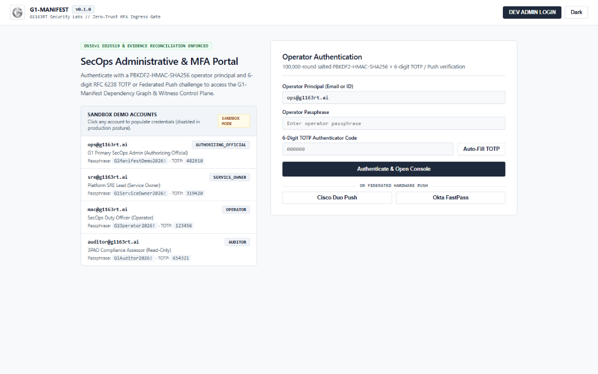
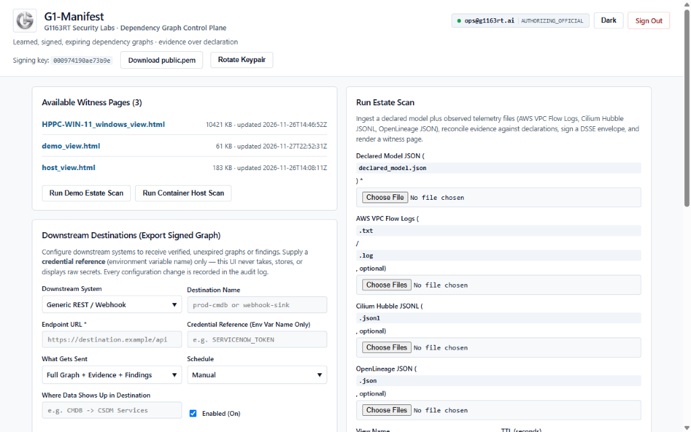
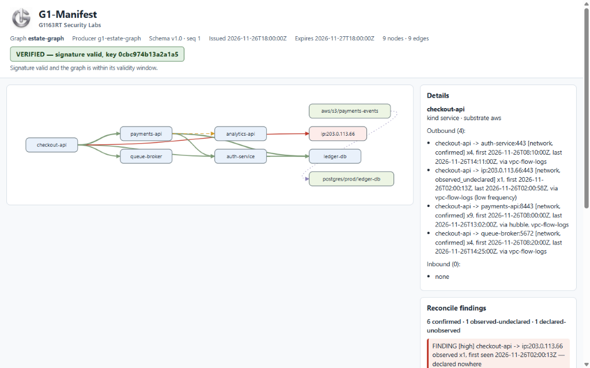
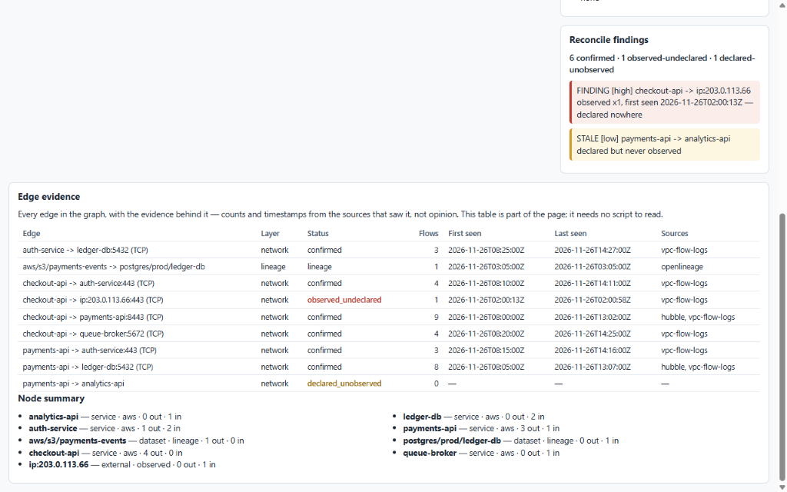
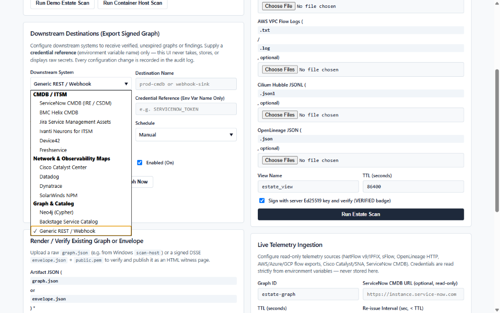
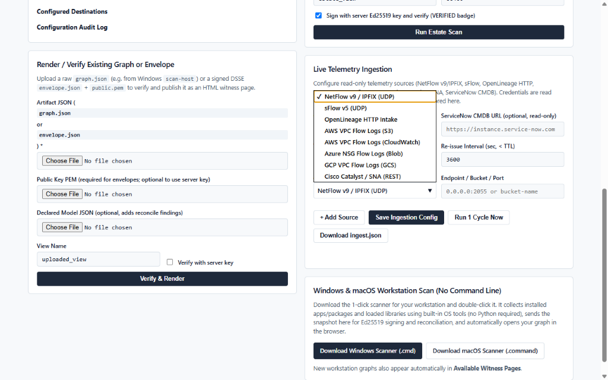

<p align="center">
  
</p>

# G1-Manifest — by G1163RT Security Labs

[](https://github.com/cgilbert61/G1-Manifest/actions/workflows/ci.yml)
[](LICENSE)
[](pyproject.toml)
[](schemas/dsse-envelope.v1.0.schema.json)
[](reports/devsecops_scan_report.md)
[](reports/devsecops_scan_report.md)
[](reports/devsecops_scan_report.md)
[](reports/devsecops_scan_report.md)
[](docs/govready_compliance_assessment_report.md)
[](CONTRIBUTING.md)

**Learned, signed, expiring dependency graphs for cloud estates and workstations — evidence over declaration (`v0.1.0`) — G1163RT Security Labs, Inc.**

> **Core Operational Principle:** **Observation proposes, a human signature disposes — expired means expired.**

---

## What Is G1-Manifest & What Problem Does It Solve?

Every containment and shielding system lives or dies on one question: *what does this service actually depend on?* Lists written by people rot — the forgotten 2 a.m. license server or partner endpoint gets cut as faithfully as an attacker's callback during an incident. **G1-Manifest** is a standalone evidence-driven dependency graph producer, reconciler, and fail-closed DSSEv1 verifier that composes with **G1-Docket** and **G1-Warrant** strictly through signed, expiring artifacts:

| Dimension | Manual Allowlists (`AllowedEgressServices`) | G1-Manifest (`evidence over declaration`) |
| :--- | :--- | :--- |
| **Source of Truth** | Human-maintained lists that silently rot | Empirical flow & module evidence (`flow_count`, `first_seen`, `last_seen`, `sources`) |
| **Rare Dependencies** | Forgotten until a 2 a.m. production outage | Preserved and flagged `low_frequency`, never averaged away |
| **Unknown Traffic / DLLs** | Blindly blocked or silently missed | Named `observed_undeclared` findings (`HIGH` for external IPs & user-writable DLLs); nothing auto-promotes |
| **Enforcement Trust** | Implicit trust in static config files | DSSEv1 Ed25519 signed & expiring envelopes; consumers fail closed via `arming_gate()` |
| **Audit & Inspection** | Database-locked dashboards | Deterministic, offline-safe HTML witness pages with static evidence tables & verification badges |

### Core Subsystems

1. **Telemetry Observation (`estate_graph/sources/`)** — Read-only ingest of AWS VPC Flow Logs, Cilium Hubble JSONL, Warrant-shaped declared estate models, OpenLineage derivations, Windows Uninstall Registry, `pip` metadata, and live loaded process modules.
2. **Deterministic Aggregation (`estate_graph/aggregate.py`)** — Merges observations into a canonical dependency graph where every edge carries empirical evidence (`flow_count`, `first_seen`, `last_seen`, `sources`). Rare flows are kept and flagged `low_frequency`, never averaged away.
3. **Reconciliation (`estate_graph/reconcile.py`, `host_reconcile.py`)** — Diffs observed evidence against declared claims into three buckets (`confirmed`, `observed_undeclared`, `declared_unobserved`). Nothing observed ever auto-promotes: observation proposes, a human signature disposes.
4. **DSSEv1 Ed25519 Signing & Fail-Closed Verification (`estate_graph/sign.py`, `verify.py`)** — Emits expiring DSSE envelopes (`application/vnd.g1163rt.estate-graph+json`, default TTL 24h). Consumers fail closed on bad signatures, unsupported schema versions, or expiry, and gate surgical shields via `arming_gate()`.
5. **Zero-Trust MFA Portal, Offline Witness Renderer & 1-Click Workstation Scanners (`estate_graph/auth.py`, `render.py`, `serve.py`)** — PBKDF2-HMAC-SHA256 + 6-digit TOTP & Push MFA login portal with RBAC, deterministic offline-safe HTML witness pages, and 1-click Windows (`.cmd`) / macOS (`.command`) workstation scanners.

---

## Visual Demonstration & Console Walkthrough

### 1. Zero-Trust MFA Login Portal (`:8088/login`)
> Every operator session is authenticated via PBKDF2-HMAC-SHA256 (`100,000` iterations) + 6-digit TOTP or 2-digit number-match Push MFA (Cisco Duo / Okta FastPass), with strict RBAC (`AUTHORIZING_OFFICIAL`, `SERVICE_OWNER`, `OPERATOR`, and read-only `AUDITOR`).

<p align="center">
  
</p>

### 2. Witness Dashboard, Estate Scanner & 1-Click Workstation Scanners (`:8088/`)
> Upload telemetry files (`declared_model.json`, AWS VPC Flow Logs, Cilium Hubble JSONL, OpenLineage JSON) to run signed estate scans, verify/render existing graphs or DSSE envelopes, rotate Ed25519 keys, or download 1-click Windows (`.cmd`) and macOS (`.command`) workstation scanners with scoped ingest tokens.

<p align="center">
  
</p>

### 3. Standalone Signed & Verified HTML Witness Page (`/demo_view.html`)
> Every witness page displays its cryptographic proof state on its face (**VERIFIED**, **EXPIRED**, or **UNSIGNED**), renders deterministic left-to-right layered SVG topology, highlights undeclared flows (like the 2 a.m. `203.0.113.66` license server) in red, and shows live click-to-inspect evidence in the Details panel.

<p align="center">
  
</p>

### 4. Static Edge Evidence Table & Node Summary (Zero-JavaScript Testimony)
> A witness must not require JavaScript to testify: every edge's flow count, first/last seen UTC timestamps, reconciliation status, and observation sources are server-rendered directly into the standalone HTML document so it works offline by double-clicking.

<p align="center">
  
</p>

### 5. Downstream Destinations Export Panel (All 13 Vendors & Audited Config)
> Configure per-destination outbound exports across **CMDB / ITSM** (ServiceNow IRE/CSDM, BMC Helix, JSM Assets, Ivanti Neurons, Device42, Freshservice), **Network & Observability Maps** (Cisco Catalyst Center, Datadog, Dynatrace, SolarWinds NPM), and **Graph & Catalog** (Neo4j, Backstage, Generic REST/Webhook) — with credential references only (no raw secrets), `full` / `delta` / `findings_only` modes, fail-closed verification, and an audited configuration log.

<p align="center">
  
</p>

### 6. Live Telemetry Ingestion & 1-Click Workstation Scanners
> Configure read-only live collectors directly in the UI (`NetFlow v9 / IPFIX`, `sFlow v5`, `OpenLineage HTTP`, `AWS S3 / CloudWatch`, `Azure NSG`, `GCP VPC`, `Cisco Catalyst / SNA`, and read-only `ServiceNow CMDB`), run on-demand cycles, or download 1-click Windows (`.cmd`) and macOS (`.command`) workstation scanners.

<p align="center">
  
</p>

---

## Repository Layout

- `estate_graph/` — Core Python package (`model.py`, `aggregate.py`, `reconcile.py`, `host_reconcile.py`, `sign.py`, `verify.py`, `render.py`, `serve.py`, `cli.py`, `sources/`, `assets/`)
- `schemas/` — JSON Schemas (Draft 2020-12) for `DependencyGraph` and DSSEv1 envelopes + `CHANGELOG.md`
- `conformance/` — Consumer Conformance Test Suite (`test_conformance.py`)
- `tests/` — Deterministic unit, integration, rendering, host-scanning, and hardening test suites
- `benchmarks/` — Empirical latency & throughput benchmark (`bench_graph.py`)
- `examples/` — Bundled synthetic estate (`demo_estate/`), `run_demo.py`, `consumer_sketch.py`, `pc_self_graph.py`, and `verify_docker_stack.py`
- `docs/` — Architecture, CLI Reference, Python SDK Guide, Benchmarks & Sizing, GovReady-Q & Federal DevSecOps reports
- `deploy/` & `charts/` & `k8s/` — Production Helm charts and Kubernetes manifests (Namespace, ConfigMap, Deployment, Service, HPA, NetworkPolicy)
- `terraform/` — Multi-cloud IaC foundation modules (`aws/`, `azure/`, `gcp/`) for KMS signing keys and WORM artifact storage
- `reports/` — Empirical verification scorecards (`verification_scorecard.json`) and compliance harness output (`compliance_report.json`)
- `scripts/` — Verification runner (`run_all_verifications.py`), Compliance Harness (`compliance_harness.py`), Mode Checker (`check_mode.py`), Interactive Operator Menu (`interactive_menu.py`)
- `.github/` — GitHub Actions CI/CD workflow (`ci.yml`), Issue Templates, and Pull Request Template
- **Community Standards & Policies** — [Contributing Guidelines](CONTRIBUTING.md), [Code of Conduct](CODE_OF_CONDUCT.md), [Security Policy](SECURITY.md), and [Apache-2.0 License](LICENSE)

---

## Core Domain Schema (`DependencyGraph` & DSSE Envelope)

| Field | Type | Layer / Scope | Description |
| :--- | :--- | :--- | :--- |
| `graph_id` | `string` | Graph | Stable identifier (e.g. `estate-graph`, `host-graph:<hostname>`) |
| `version` | `string` | Graph | Schema version (`"1.0"`); consumers fail closed on unknown versions |
| `issued_at` / `expires_at` | `int` (UTC epoch) | Graph | Validity window; expired means expired |
| `nodes[]` | `ServiceNode[]` | Graph | `id`, `kind` (`service`, `external`, `dataset`, `package`, `process`, `library`, `system-library`), `substrate`, `labels` |
| `edges[]` | `Edge[]` | `network` \| `lineage` \| `package` \| `observed-load` | Directed edge with `port`, `protocol`, `low_frequency`, and `evidence` (`flow_count`, `first_seen`, `last_seen`, `sources`) |
| `payloadType` | `string` | DSSE Envelope | `application/vnd.g1163rt.estate-graph+json` |
| `signatures[]` | `Signature[]` | DSSE Envelope | Ed25519 signature over DSSEv1 PAE with 16-char SHA-256 `keyid` |

---

## Quickstart (Local Evaluation, Standalone CLI/SDK & Demo)

### 0. Install Dependencies

```bash
python3 -m venv .venv
source .venv/bin/activate          # Windows: .venv\Scripts\activate
pip install -e ".[host]" pytest
```

### Standalone CLI & Consumer SDK (`g1-manifest` / `estate-graph`)

> [!IMPORTANT]
> **Minimal Dependencies**: Runtime verification and signing require only `cryptography>=42` (everything else is Python stdlib; `psutil>=5.9` is optional for live host module observation).

```bash
g1-manifest --help
g1-manifest --check-mode
```

### 1. Run the Reproducible End-to-End Demo

```bash
python -m examples.run_demo
```

### 2. Run the Full Test & Conformance Suite

```bash
pytest -v
pytest -v conformance/
```

### 3. Exercise the Operator CLI

```bash
g1-manifest keygen --out-dir keys/
g1-manifest build --declared examples/demo_estate/declared_model.json \
  --flowlogs examples/demo_estate/vpc_flow_logs.txt \
  --hubble examples/demo_estate/hubble.jsonl \
  --lineage examples/demo_estate/lineage.json \
  --out graph.json
g1-manifest sign --graph graph.json --key keys/private.pem --ttl 86400 --out envelope.json
g1-manifest verify --envelope envelope.json --pub keys/public.pem
g1-manifest render --envelope envelope.json --pub keys/public.pem \
  --declared examples/demo_estate/declared_model.json --out view.html
```

### 4. Interactive Operator & Auditor Control Menu

```bash
python scripts/interactive_menu.py
```

---

## One-Click Automated Docker Installers

- **Windows**: `install.bat`
- **Linux / macOS**: `chmod +x install.sh && ./install.sh`

Or directly with Docker Compose:

```bash
docker compose up -d --build
```

---

## Troubleshooting & Automated Health Polling (PowerShell)

```powershell
1..30 | ForEach-Object {
  try {
    $r = Invoke-WebRequest -Uri http://127.0.0.1:8088/health -UseBasicParsing -TimeoutSec 2
    if ($r.StatusCode -eq 200) { Write-Host "Healthy: $($r.Content)"; break }
  } catch { Start-Sleep -Seconds 1 }
}
```

---

## Service Architecture & HTTP Endpoints

| Port | Service Component | UI / Endpoint | Key Role & Scope |
| :--- | :--- | :--- | :--- |
| `8088` (host) -> `8080` (container) | `G1-Manifest` Witness Server | `http://127.0.0.1:8088/` | Interactive dashboard, estate scan upload, 1-click Windows/macOS scanners, and standalone HTML witness views |

```text
G1-Manifest HTTP Surface (:8080)
├── GET  /                           MFA Login Portal (unauthenticated) / Witness Dashboard (authenticated)
├── GET  /login                      Zero-Trust PBKDF2 + 6-Digit TOTP & Push Login Portal
├── GET  /logout                     Clear session cookie and return to /login
├── GET  /health                     Container health check ({"status":"ok","views":N})
├── GET  /<view>.html                Standalone offline-safe HTML witness page (session-gated)
├── GET  /api/views                  JSON metadata list of rendered witness pages
├── GET  /api/keys/public.pem        Download active Ed25519 verification public key
├── GET  /api/agent/windows.cmd      1-click Windows workstation scanner (embeds scoped ingest token)
├── GET  /api/agent/macos.command    1-click macOS workstation scanner (embeds scoped ingest token)
├── POST /api/auth/login             PBKDF2-HMAC-SHA256 + 6-digit TOTP authentication
├── POST /api/auth/push-challenge    Cisco Duo / Okta FastPass push dispatch
├── POST /api/auth/push-verify       2-digit number-match push verification
├── POST /api/scan/estate            Ingest telemetry, reconcile, sign, and render
├── POST /api/scan/host              Run container host scan
├── POST /api/scan/demo              Re-run bundled demo estate scan
├── POST /api/ingest/host            Ingest Windows/macOS workstation snapshot
├── POST /api/render                 Verify & render uploaded graph.json or envelope.json
└── POST /api/keys/rotate            Rotate server Ed25519 keypair
```

### Operator MFA Login Portal & Sandbox Demo Accounts (`http://127.0.0.1:8088`)

In local evaluation mode (disabled automatically when `MANIFEST_PRODUCTION=true`), the login portal includes click-to-fill sandbox accounts matching **G1-Warrant**:

| Principal (`email` / alias) | Role | Sandbox Passphrase | 6-Digit TOTP | Access Scope |
| :--- | :--- | :--- | :--- | :--- |
| `ops@g1163rt.ai` (`admin`) | `AUTHORIZING_OFFICIAL` | `G1ManifestDemo2026!` | `482910` | Full scan, render, and key rotation |
| `sre@g1163rt.ai` (`operator1`) | `SERVICE_OWNER` | `G1ServiceOwner2026!` | `319420` | Full scan, render, and key rotation |
| `mac@g1163rt.ai` | `OPERATOR` | `G1Operator2026!` | `123456` | Full scan, render, and key rotation |
| `auditor@g1163rt.ai` (`auditor1`) | `AUDITOR` | `G1Auditor2026!` | `654321` | Read-only witness inspection (`403` on mutations) |

---

## Ecosystem Integrations & Third-Party Open Source Software

G1-Manifest integrates with **G1-Docket** and **G1-Warrant** exclusively through verified DSSEv1 artifacts (`application/vnd.g1163rt.estate-graph+json`).

| Package / Project | Version | Upstream License | Project URL / Source | Primary Role |
| :--- | :--- | :--- | :--- | :--- |
| `cryptography` | `>=42` | Apache-2.0 / BSD-3-Clause | https://github.com/pyca/cryptography | Ed25519 key generation, DSSE signing & verification |
| `psutil` (optional) | `>=5.9` | BSD-3-Clause | https://github.com/giampaolo/psutil | Live process loaded-module observation (`scan-host`) |
| `pytest` (dev) | `>=8` | MIT | https://github.com/pytest-dev/pytest | Unit, conformance, and hardening test runner |

---

## Observability, Security Scans & Verification

- **Health Probe:** `GET /health` (`200 OK` JSON) wired into `Dockerfile` `HEALTHCHECK` and `k8s/deployment.yaml` liveness/readiness probes.
- **Empirical Verification Scorecard:** Run `python scripts/run_all_verifications.py` to execute unit/integration tests, consumer conformance, demo, compliance harness, and latency benchmarks into [`reports/verification_scorecard.json`](reports/verification_scorecard.json).
- **Scale Baseline:** See [`SCALE.md`](SCALE.md) (5,000-edge control and 50,000-edge scale measurements across `aggregate → reconcile → sign → verify → render`).
- **Ingestor Contract & Run Receipts:** See [`docs/INGESTORS.md`](docs/INGESTORS.md) and [`docs/INGESTOR-RUNS.md`](docs/INGESTOR-RUNS.md).

### Honest Source Status

| Source | Status | Notes |
| :--- | :--- | :--- |
| **NetFlow v9 / IPFIX UDP** (`netflow-v9`, `ipfix`) | `live-tested` (loopback UDP) | Binary RFC 3954 / RFC 7011 decoder + live UDP listener verified in 2-cycle runner proof |
| **sFlow v5 UDP** (`sflow`) | `live-tested` (loopback UDP) | Binary RFC 3176 decoder + live UDP listener; preserves `sampling_rate` on edge labels |
| **OpenLineage HTTP** (`openlineage`) | `live-tested` (loopback HTTP) | `POST /api/v1/lineage` intake verified in 2-cycle runner proof; stays on `layer="lineage"` |
| **Windows Registry & Loaded Modules** (`scan-host`) | `live-tested` (Windows 11 host) | Executed live on local Windows workstation + fixture-tested on Linux |
| **AWS VPC Flow Logs (S3 / CloudWatch)** | `fixture-tested` | Checkpointed & deduplicated collectors; requires live AWS account for live-estate proof |
| **Azure NSG Flow Logs v2 / GCP VPC Flow Logs** | `fixture-tested` | Pure parsers + checkpointed collectors; requires live cloud tenants for live-estate proof |
| **Cilium Hubble Live Stream** | `fixture-tested` | Reuses `parse_hubble` identity logic + cursor checkpoint; requires live Hubble Relay for live-estate proof |
| **Cisco Catalyst Center + SNA** | `fixture-tested` | Read-only REST adapter (NetFlow/IPFIX already covers Cisco hardware flows) |
| **ServiceNow CMDB** (`servicenow-cmdb`) | `fixture-tested` | Read-only Table API -> `DeclaredModel` preserving `servicenow_sys_id`; no write-back |

### Honest Downstream Destination Status ([Export Receipts](docs/EXPORT-RUNS.md))

| Group | Destination | Status | Notes |
| :--- | :--- | :--- | :--- |
| **Graph & Catalog** | Generic REST / Webhook (`webhook`) | `live-tested` (loopback HTTP) | Configured via Manifest UI, exported verified graph, audited in `destination_audit.jsonl` |
| **Graph & Catalog** | Neo4j (`neo4j`), Backstage (`backstage`) | `fixture-tested` | Parameterized Cypher HTTP & `backstage.io/v1alpha1` entities preserving `envelope_id` & `expires_at` |
| **CMDB / ITSM** | ServiceNow IRE (`servicenow`), BMC Helix (`bmc-helix`), JSM Assets (`jsm-assets`), Ivanti (`ivanti-itsm`), Device42 (`device42`), Freshservice (`freshservice`) | `fixture-tested` | Vendor-documented REST/IRE payload formats; requires live sandbox tenant for `live-tested` |
| **Network & Observability** | Cisco Catalyst (`cisco-catalyst`), Datadog (`datadog`), Dynatrace (`dynatrace`), SolarWinds NPM (`solarwinds-npm`) | `fixture-tested` | Vendor-documented topology/catalog/event APIs; requires live tenant for `live-tested` |
- **Fuzz Testing Report ([Full Report](reports/fuzz_report.md)):** Property-based fuzzing via **Hypothesis** (`fuzz/test_hypothesis_fuzz.py`: **10/10 targets PASS**, `1,500` generated examples, 2 edge cases caught & fixed) and coverage-guided `libFuzzer` harnesses via **Atheris** (`fuzz/atheris_harnesses/`, running in GitHub Actions CI & `fuzz/Dockerfile.atheris`).
- **Latest Empirical DevSecOps Scan ([Full Report](reports/devsecops_scan_report.md)):**

| Scanner | Scope | Status | Empirical Result |
| :--- | :--- | :--- | :--- |
| **Gitleaks** | Git history & repository secrets | `EXECUTED` | **0 leaks** |
| **Semgrep** | Python SAST (`.semgrep.yml` + `p/python`, 154 rules) | `EXECUTED` | **0 findings** |
| **Checkov** | Dockerfile, Helm, Kubernetes, Terraform | `EXECUTED` | **188 passed, 0 failed** (`70/70` Dockerfile, `91/91` K8s, `25/25` Terraform, `2/2` Helm) |
| **Trivy Image** | `g1-manifest:latest` (Alpine 3.24) OS + Python CVEs & secrets | `EXECUTED` | **0 CRITICAL / 0 HIGH**, **0 Python CVEs**, **0 secrets** (5 MEDIUM, 1 LOW) |
| **Trivy FS** | Repository IaC misconfigurations, vulns & secrets | `EXECUTED` | **0 CRITICAL / 0 HIGH**, **0 vulns**, **0 secrets** (3 MEDIUM) |
| **Hypothesis Fuzz** | 10 property-based fuzz targets (`fuzz/`) | `EXECUTED` | **10/10 PASS** (`1,500` examples, 2 edge cases remediated) |
| **Atheris Fuzz** | 4 coverage-guided `libFuzzer` harnesses (`fuzz/atheris_harnesses/`) | `EXECUTED` | **4/4 PASS** (`8,000` libFuzzer runs in `atheris 3.0.0` Docker, `0` crashes) |
| **oss-scanner** | Standalone OSS/license scanner | `SKIPPED` | Not installed locally (enrolled via `anthropics/oss-scanner#1615`) |

---

## Community & Security Standards

- **[Contributing Guidelines](CONTRIBUTING.md)**
- **[Code of Conduct](CODE_OF_CONDUCT.md)**
- **[Security Policy](SECURITY.md)**
- **[Issue Templates](.github/ISSUE_TEMPLATE/)**
- **[Pull Request Template](.github/pull_request_template.md)**
- **[Apache-2.0 License](LICENSE)**
